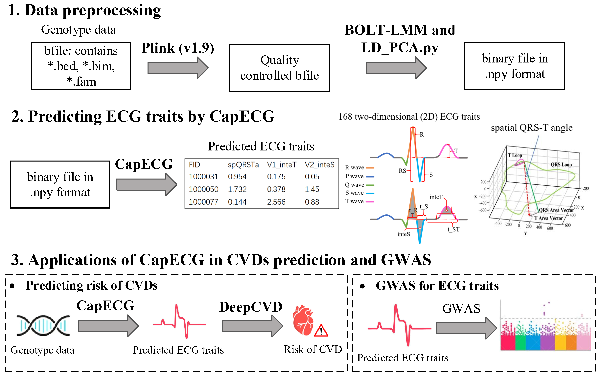

# CapECG: Empowering genetic discoveries and cardiovascular risk assessment by predicting electrocardiograms from genotype
CapECG is an attention-based Capsule Network for ECG traits prediction using genotype data. 

### Installation

To reproduce **CapECG**, we suggest first create a conda environment by:

~~~shell
conda create -n CapECG python=3.8
conda activate CapECG
~~~

and then install the required package:

### Requirements
- `pytorch(1.8.1)`
- `torchvision(0.9.1)`
- `matplotlib(3.3.4)`
- `pandas(1.1.5)`
- `tqdm(4.62.3)`
- `numpy(1.19.2)`
- `scikit-learn(1.0.2)`
- `scipy(1.6.2)`

PLINK (v1.90) can be downloaded from  https://www.cog-genomics.org/plink/ .

### 1. Perform GWAS analysis

BOLT-LMM is used to perform GWAS for training data. You need to provide the phenotype file (pheno_file) with FID, IID, age, sex, center, batch, trait and PC1-10. The GWAS result will be saved in "out_file". The code of BOLT-LMM for GWAS is availabe at  https://alkesgroup.broadinstitute.org/BOLT-LMM/BOLT-LMM_manual.html, and BOLT-LMM can be run by the code:

```
./BOLT-LMM/bolt \
--bfile=$file_bfile --LDscoresFile=$ld_file \
--lmm \
--phenoFile=$pheno_file --phenoCol=$trait \
--covarFile=$pheno_file --qCovarCol=age --covarCol=sex --covarCol=center --covarCol=batch --qCovarCol=PC{1:10} --covarMaxLevels=120 \
--modelSnps=$modsnp_file \
--statsFile=$out_file
```

### 2. Perform LD-PCA analysis

LD-PCA is used to reduce the data dimension using LD information for genotype data. The code is:

```
python LD_PCA.py --ECG_trait $trait \ #ECG trait for prediction
		--GWAS_path $GWAS_file \ #GWAS result
		--save_dir $save_dir \ #the path of the folder for saving the results
		--train_FID_path $train_FID \ #the list of human ID for training set (train_FID.txt)
		--test_FID_path $test_FID \ #the list of human ID for test set (test_FID.txt)
		--bfile $bfile # genotype data in bfile format
```
By running the above command, two files will be generated under specific path: 
- "${save_dir}/npy_data/train.npy": a binary file storing the genotype data in .npy format for training set
- "${save_dir}/npy_data/test.npy": a binary file storing the genotype data in .npy format for test set

### 3. Training CapECG for ECG traits prediction

```
python train_CapECG.py  --ECG_trait $trait \ #ECG trait for prediction
		--train_geno_path $train_geno_file \ #"${save_dir}/npy_data/train.npy"
		--test_geno_path $test_geno_file \ #"${save_dir}/npy_data/test.npy"
		--train_pheno_path $train_pheno_file \ #the csv file containing FID and trait label for training set
		--test_pheno_path $test_pheno_file \ #the csv file containing FID and trait label for test set
		--save_model_path $save_model_file \ 
		--device $device \ #"cuda:0"
		--epochs_num $epochs_num \
		--batch_size $batch_size \
		--num_workers $num_workers \
		--lr $learning_rate \
		--hidden_dim $hidden_dim \
		--num_layers $num_layers 
```

## Citation

If you find our codes useful, please consider citing our work:

~~~bibtex


@article{
  title={Empowering genetic discoveries and cardiovascular risk assessment by predicting electrocardiograms from genotype},
  author={Siying Lin, Yuedong Yang*, Huiying Zhao*},
  journal={npj Digital Medicine},
  year={2026},
}
~~~
